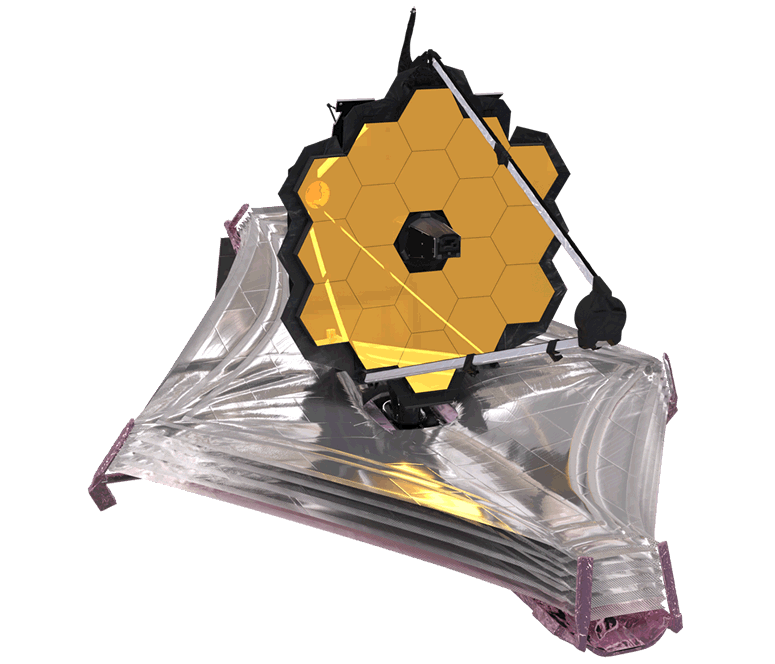

# James Webb Space Telescope (JWST)

## Overview
The James Webb Space Telescope (JWST) is a *space telescope* designed to conduct **infrared astronomy**. It is the **largest telescope** in space, and is equipped with high-resolution and high-sensitivity instruments, allowing it to view objects too old, distant, or faint for the Hubble Space Telescope This enables investigations across many fields of astronomy and cosmology, such as **observation of the first stars** and **the formation of the first galaxies, and detailed atmospheric characterization of potentially habitable exoplanets**.

## Features and Design
The design emphasizes the near to mid-infrared for several reasons:
- high-redshift (very early and distant) objects have their visible emissions shifted into the infrared, and therefore their light can be observed only via infrared astronomy;
- Infrared light passes more easily through dust clouds than visible light;
colder objects such as debris disks and planets emit most strongly in the infrared;
- These infrared bands are difficult to study from the ground or by earlier space telescopes such as Hubble.

## Location and Orbit
Webb operates in a *halo orbit*, circling a point in space known as the Sun–Earth L2 Lagrange point, approximately 1,500,000 km (930,000 mi) **beyond Earth's orbit around the Sun**. Its actual position varies between about 250,000 and 832,000 km (155,000–517,000 mi) from L2 as it orbits, keeping it out of both *Earth* and *Moon's shadow*.

## Scientific Instruments
1. NIRCam (Near Infrared Camera)
2. NIRSpec (Near Infrared Spectrograph)
3. MIRI (Mid-Infrared Instrument)
4. FGS/NIRISS (Fine Guidance Sensor and Near Infrared Imager and Slitless Spectrograph)

## Comparison with Other Telescopes
|Name|Launch year|Wavelength (μm)|Aperture (m)|Cooling|
|---|---|---|---|---|
|Hubble Wide Field Camera 3 (WFC3)|2009|0.2–1.7|2.4|Passive and thermo-electric|
|Herschel Space Observatory|2009|55–672|3.5|Helium|
|James Webb Space Telescope|2021|0.6–28.5|6.5|Passive and cryocooler (MIRI)|

## Software
Webb uses a modified version of JavaScript, called Nombas ScriptEase 5.00e, for its operations; it follows the ECMAScript standard and "allows for a modular design flow, where on-board scripts call lower-level scripts that are defined as functions". Furthermore, "The script interpreter is run by the flight software, which is written in C++. The flight software operates the spacecraft and the science instruments."

Sources: [Wikipedia James Webb Space Telescope](https://en.wikipedia.org/wiki/James_Webb_Space_Telescope)
# James Webb Space Telescope (JWST)

## Overview
The James Webb Space Telescope (JWST) is a *space telescope* designed to conduct **infrared astronomy**. It is the **largest telescope** in space, and is equipped with high-resolution and high-sensitivity instruments, allowing it to view objects too old, distant, or faint for the Hubble Space Telescope This enables investigations across many fields of astronomy and cosmology, such as **observation of the first stars** and **the formation of the first galaxies, and detailed atmospheric characterization of potentially habitable exoplanets**.

## Features and Design
The design emphasizes the near to mid-infrared for several reasons:
- high-redshift (very early and distant) objects have their visible emissions shifted into the infrared, and therefore their light can be observed only via infrared astronomy;
- Infrared light passes more easily through dust clouds than visible light;
colder objects such as debris disks and planets emit most strongly in the infrared;
- These infrared bands are difficult to study from the ground or by earlier space telescopes such as Hubble.

## Location and Orbit
Webb operates in a *halo orbit*, circling a point in space known as the Sun–Earth L2 Lagrange point, approximately 1,500,000 km (930,000 mi) **beyond Earth's orbit around the Sun**. Its actual position varies between about 250,000 and 832,000 km (155,000–517,000 mi) from L2 as it orbits, keeping it out of both *Earth* and *Moon's shadow*.

## Scientific Instruments
1. NIRCam (Near Infrared Camera)
2. NIRSpec (Near Infrared Spectrograph)
3. MIRI (Mid-Infrared Instrument)
4. FGS/NIRISS (Fine Guidance Sensor and Near Infrared Imager and Slitless Spectrograph)

## Comparison with Other Telescopes
|Name|Launch year|Wavelength (μm)|Aperture (m)|Cooling|
|---|---|---|---|---|
|Hubble Wide Field Camera 3 (WFC3)|2009|0.2–1.7|2.4|Passive and thermo-electric|
|Herschel Space Observatory|2009|55–672|3.5|Helium|
|James Webb Space Telescope|2021|0.6–28.5|6.5|Passive and cryocooler (MIRI)|

## Software
Webb uses a modified version of JavaScript, called Nombas ScriptEase 5.00e, for its operations; it follows the ECMAScript standard and "allows for a modular design flow, where on-board scripts call lower-level scripts that are defined as functions". Furthermore, "The script interpreter is run by the flight software, which is written in C++. The flight software operates the spacecraft and the science instruments."

Sources: [Wikipedia James Webb Space Telescope](https://en.wikipedia.org/wiki/James_Webb_Space_Telescope)